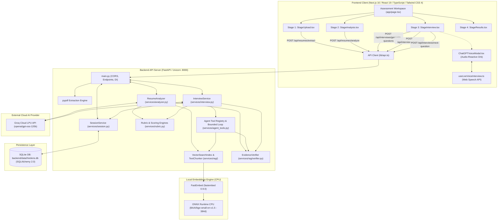

# HireLens — AI-Powered Recruitment Intelligence

> **"Beyond Resumes. Proving Skills."**

HireLens is an AI-powered technical recruitment and candidate evaluation platform designed to bridge the gap between static resume claims and demonstrated software engineering competence. Instead of relying on keyword matching or unverified LLM summaries, HireLens combines **PDF resume extraction**, **local RAG vector retrieval**, **bounded agent tool calling**, **deterministic Python scoring**, **SQLite persistence**, and a **browser-native live voice interview experience**.

---

## Table of Contents

1. [Project Overview](#project-overview)
2. [Key Implemented Features](#key-implemented-features)
3. [System Architecture & Data Flow](#system-architecture--data-flow)
4. [Technology Stack](#technology-stack)
5. [Agentic AI Architecture](#agentic-ai-architecture)
6. [RAG Pipeline & Verification](#rag-pipeline--verification)
7. [Voice Architecture & Browser Speech Limitations](#voice-architecture--browser-speech-limitations)
8. [Local Installation & Setup (Windows PowerShell)](#local-installation--setup-windows-powershell)
9. [Testing Commands & Verified Results](#testing-commands--verified-results)
10. [Known Limitations](#known-limitations)
11. [Project Screenshots](#project-screenshots)
12. [Future Improvements](#future-improvements)

---

## Project Overview

Traditional technical screening relies on two flawed extremes: blunt keyword filters that reject qualified candidates, or unstructured LLM evaluations that hallucinate skills and produce arbitrary scores.

HireLens replaces both with an **evidence-first recruitment OS**:
- **Grounds evaluation in real evidence:** Every match claim is retrieved through semantic vector search and verified verbatim against the candidate's actual text.
- **Conducts adaptive technical interviews:** An active agent decision loop formulates conversational, progressive questions that calibrate in real time to candidate performance.
- **Separates reasoning from arithmetic:** LLMs extract qualitative insights, but all numerical match percentages and interview composite scores are computed via deterministic Python scoring algorithms.
- **Preserves candidate session state:** Multi-turn interviews, candidate answers, and rubric evaluations are stored in a local SQLite database for complete auditability.

---

## Key Implemented Features

| Feature | Implementation Details | Code Reference |
| :--- | :--- | :--- |
| **PDF Extraction** | Streamlined binary ingestion using `pypdf.PdfReader` with magic-byte (`%PDF-`) validation, 5 MB file size limit, 30-page ceiling, encryption checks, and text extraction error trapping. | [`backend/main.py`](file:///k:/code/HireLens/backend/main.py#L61-L166) |
| **AI Resume Analysis** | Structured LLM extraction via Groq Cloud (`openai/gpt-oss-120b`) enforcing strict Pydantic JSON schemas with prompt injection guards, extracting skills, work experience, education, and requirement match statuses (`matched`, `partially_matched`, `not_demonstrated`). | [`backend/services/analyzer.py`](file:///k:/code/HireLens/backend/services/analyzer.py#L107-L227) |
| **RAG Evidence Retrieval** | In-memory semantic vector indexing using `BAAI/bge-small-en-v1.5` embeddings via FastEmbed and ONNX Runtime CPU. Employs 450-character boundary-aware chunking with 100-character overlap and cosine similarity retrieval. | [`backend/services/rag/`](file:///k:/code/HireLens/backend/services/rag/) |
| **Evidence Verification** | Python programmatic quote verifier (`EvidenceVerifier`) that tests cited quotes against raw resume and answer texts using verbatim and normalized substring matching, flagging hallucinated citations. | [`backend/services/rag/verifier.py`](file:///k:/code/HireLens/backend/services/rag/verifier.py) |
| **Adaptive Interviews** | 6-stage progressive conversational arc (Warm-Up $\rightarrow$ Project Overview $\rightarrow$ Deep Dive $\rightarrow$ Topic Transition $\rightarrow$ Technical Depth $\rightarrow$ Wrap-Up) calibrated to candidate answers. | [`backend/services/interview.py`](file:///k:/code/HireLens/backend/services/interview.py#L519-L640) |
| **Agent Tool Calling** | Bounded agent decision loop executing three registered tools (`search_resume_evidence`, `get_interview_evidence`, `plan_next_interview_action`) with cycle limits, call deduplication, and safe structured fallbacks. | [`backend/services/agent_tools.py`](file:///k:/code/HireLens/backend/services/agent_tools.py) |
| **Deterministic Scoring** | Decoupled mathematical scoring engines in Python: weighted resume-job alignment calculation and 4-criteria interview arithmetic (`technical_correctness`, `problem_solving`, `relevance`, `communication`). | [`backend/services/rubric.py`](file:///k:/code/HireLens/backend/services/rubric.py), [`backend/services/interview.py`](file:///k:/code/HireLens/backend/services/interview.py#L464-L475) |
| **SQLite Persistence** | SQLAlchemy 2.0 database models storing assessment sessions, extracted resumes, RAG analysis results, interview questions, candidate answers, and final evaluation reports. | [`backend/db/database.py`](file:///k:/code/HireLens/backend/db/database.py), [`backend/db/models.py`](file:///k:/code/HireLens/backend/db/models.py) |
| **Live Voice Interviews** | Hands-free browser speech recognition and synthesis with dynamic turn-taking silence detection (2.0s terminal / 2.8s mid-sentence), interim speech protection, and a Web Audio API reactive canvas Orb. | [`frontend/src/components/voice/`](file:///k:/code/HireLens/frontend/src/components/voice/), [`frontend/src/lib/speech/`](file:///k:/code/HireLens/frontend/src/lib/speech/) |

---

## System Architecture & Data Flow

### Architecture Topology



### End-to-End Candidate Assessment Lifecycle

1. **Upload & Ingestion:** The candidate uploads a PDF resume. FastAPI validates the file size ($\le 5\text{ MB}$), verifies the `%PDF-` header magic bytes, and extracts plain text across pages (capped at 30 pages) using `pypdf`. A persistent session record is created in SQLite.
2. **Chunking & Local Vector Indexing:** Resume text is parsed into 450-character overlapping chunks using `TextChunker`. Chunks are transformed into 384-dimensional dense vectors using `BAAI/bge-small-en-v1.5` via FastEmbed and ONNX Runtime CPU.
3. **Structured Resume Analysis:** The resume chunks and target job description are sent to Groq (`openai/gpt-oss-120b`) with a constrained JSON schema. The model matches candidate experience against job requirements.
4. **Programmatic Verification & Alignment Scoring:** `EvidenceVerifier` verifies cited evidence quotes against the source resume. `calculate_deterministic_score` evaluates requirement alignment mathematically in Python. Results are saved to SQLite.
5. **Initial Question Formulation:** `InterviewService.generate_questions` creates an initial set of questions adhering to a progressive structure (Stage A: Warm-Up, Stage B: Project Overview, Stage C: Project Deep Dive).
6. **Adaptive Interview Turn (Voice or Text):** The candidate answers either via text input or hands-free via the Web Speech API voice modal.
7. **Answer Evaluation:** Groq evaluates the candidate's answer across 4 criteria (`technical_correctness`, `problem_solving`, `relevance`, `communication`) on a 1.0–5.0 scale. Python calculates the arithmetic composite score and percentage, while `EvidenceVerifier` validates quotes against the answer.
8. **Agentic Decision Loop:** `InterviewService.get_next_question` initiates a bounded 2-cycle tool loop. The model queries resume evidence, checks interview history for repetitions, and plans the next action against question budgets before selecting the next question.
9. **Final Assessment Report:** When the question budget is met, the session transitions to completion. A consolidated markdown evaluation report pairing resume alignment, multi-turn interview scores, and verified evidence is generated and persisted.

---

## Technology Stack

The table below contrasts previously planned technologies with the **actual verified technologies** operating in the codebase:

| Layer / Component | Planned / Prior Concept | Actual Implemented Stack | Version / Source |
| :--- | :--- | :--- | :--- |
| **Frontend Framework** | Next.js | **Next.js (App Router)** | `16.4.2` |
| **Client UI Library** | React | **React** | `19.3.0` |
| **Language (Frontend)** | TypeScript | **TypeScript** | `^5` |
| **Styling** | Tailwind CSS | **Tailwind CSS (Turbopack)** | `^4.0` |
| **Icons** | Lucide React | **lucide-react** | `^1.59.0` |
| **Backend Framework** | FastAPI | **FastAPI** | `0.146.0` |
| **Language (Backend)** | Python | **Python** | `3.11+` (tested on `3.14.6`) |
| **ASGI Web Server** | Uvicorn | **Uvicorn** | `0.54.0` |
| **AI LLM Inference** | Ollama (Local) | **Groq Cloud LPU SDK** | `groq >= 1.7.0` |
| **Primary LLM Model** | Mistral / Llama Local | **`openai/gpt-oss-120b`** | Structured JSON schema mode |
| **Embeddings & Vector Model**| pgvector / Remote APIs | **FastEmbed (`bge-small-en-v1.5`)** | `fastembed >= 0.9.0` (384-dim) |
| **Vector Inference Engine** | PostgreSQL / pgvector | **ONNX Runtime (CPU)** | `onnxruntime == 1.31.0` |
| **Vector Storage** | pgvector | **In-Memory Dense Cosine Matrix** | `numpy >= 2.0.0` dot product |
| **Database & ORM** | PostgreSQL / Supabase | **SQLite + SQLAlchemy 2.0** | `sqlite3`, `sqlalchemy >= 2.0.0` |
| **Agent Orchestration** | LangGraph | **Custom Bounded Tool Loop** | Native Python in `InterviewService` |
| **Tool Protocol** | Model Context Protocol (MCP)| **Groq Function / Tool Calling** | Custom Pydantic tool registry |
| **Voice / Speech Engine** | Realtime WebRTC / ElevenLabs| **Web Speech API + Canvas Web Audio** | Browser native STT & TTS |
| **PDF Parsing** | Unspecified | **pypdf** | `pypdf == 6.21.1` |
| **Validation & Modeling** | Pydantic | **Pydantic v2** | `pydantic == 2.14.1` |
| **Backend Testing** | Pytest | **Pytest** | `pytest >= 9.1.1` (80 tests passing) |
| **Frontend Testing** | Playwright | **Node.js Native Test Runner** | `node --test` (87 tests passing) |

---

## Agentic AI Architecture

Rather than executing static prompt chains, the HireLens interview system operates as an **agentic, tool-grounded decision engine**:

```
+-----------------------------------------------------------------------------------+
|                            CANDIDATE INTERVIEW TURN                               |
|                  (Browser Voice Recognition / Text Mode Input)                    |
+------------------------------------------+----------------------------------------+
                                           |
                                           v
+-----------------------------------------------------------------------------------+
|               FastAPI Answer Evaluation (services/interview.py)                   |
|  - Groq 4-Criteria Assessment (Technical, Problem-Solving, Relevance, Comm)       |
|  - Deterministic Python Scoring Formula: composite_score = (s1 + s2 + s3 + s4) / 4|
|  - EvidenceVerifier: Programmatic Verbatim Quote Search                           |
+------------------------------------------+----------------------------------------+
                                           |
                                           v
+-----------------------------------------------------------------------------------+
|           AGENT DECISION LOOP: get_next_question (InterviewService)               |
|                                                                                   |
|  1. Context Scoping:                                                              |
|     - Candidate Resume Text (from SQLite or request payload)                      |
|     - Full Multi-turn Transcript History & Verified Scores                        |
|     - Remaining Question Budget (Deterministic Python Guard)                      |
|                                                                                   |
|  2. Bounded Tool Cycle (Max 2 Iterations, Groq Tool Calling):                     |
|     +--------------------------------------------------------------------------+  |
|     |  Tool Registry (services/agent_tools.py)                                 |  |
|     |  - search_resume_evidence: Candidate-isolated RAG Vector Search & Quote  |  |
|     |                           Verification (Absence != Inability policy)     |  |
|     |  - get_interview_evidence: Prior turn search, score history, duplicate   |  |
|     |                           skill repetition warning                       |  |
|     |  - plan_next_interview_action: Validates strategy against budget & stage |  |
|     |                                (follow-up, deep dive, advance, wrap-up)  |  |
|     +--------------------------------------------------------------------------+  |
|     |  Guardrails: Repeated input detection, argument schema validation,       |  |
|     |              cycle limits, safe fallback on provider error               |  |
|     +--------------------------------------------------------------------------+  |
|                                                                                   |
|  3. Structured Decision Output:                                                   |
|     - Sanitized acknowledgement (1-4 words)                                       |
|     - Next progressive question (under 30 words, 1 question at a time)            |
|     - Safe User-Facing Agent Activities (action, summary, details, timestamp)     |
+------------------------------------------+----------------------------------------+
                                           |
                                           v
+-----------------------------------------------------------------------------------+
|                        FRONTEND PRESENTATION & AUDIO                              |
|  - Live Voice Modal (ChatGPT-Style Orb + Subtitles + Real-Time Activity Pill)     |
|  - Transcript Drawer (Evidence Grounding Log + Scorecards + Normalized Terms)     |
|  - Text Mode (Adaptive Context + Real-Time Grounding Badges)                      |
+-----------------------------------------------------------------------------------+
```

### The Three Implemented Agent Tools

All agent tools are defined in [`backend/services/agent_tools.py`](file:///k:/code/HireLens/backend/services/agent_tools.py) and executed through `AgentToolRegistry`:

#### 1. `search_resume_evidence`
- **Purpose:** Semantically indexes and searches the candidate's resume for specific technical claims, frameworks, or architectural achievements.
- **Inputs:** `claim` (string, required), `technical_topic` (string, optional).
- **Outputs:** `found` (boolean), `matched_keywords` (list), `evidence_chunks` (character offsets and relevance scores), `verified_quotes` (verbatim verified text), `notes`.
- **Absence $\ne$ Inability Policy:** If a claim is not found in the resume, the tool explicitly notes that **absence from the resume does not mean the candidate lacks competence**. It instructs the agent to ask an open-ended conversational question rather than penalizing the candidate.

#### 2. `get_interview_evidence`
- **Purpose:** Searches completed interview turns in the active session to inspect prior questions, answers, and scores.
- **Inputs:** `topic` (string, optional filter).
- **Outputs:** `total_turns_completed`, `skills_covered`, `repeated_skills`, `average_score`, `matching_turns`, `warning`.
- **Anti-Repetition Guard:** If a skill has already been tested multiple times, the tool issues an explicit warning preventing the agent from cycling on the same topic.

#### 3. `plan_next_interview_action`
- **Purpose:** Evaluates strategic interview routing against deterministic budget rules before generating the question.
- **Supported Actions:** `ask_follow_up`, `investigate_claim`, `increase_difficulty`, `change_topic`, `wrap_up`.
- **Deterministic Python Control:** If `remaining_budget <= 0` or total questions meet `max_budget`, this tool forcefully overrides any proposed action to `wrap_up` with status `budget_exhausted`, stopping further LLM generation.

### Guardrails of the Bounded Decision Loop

1. **Cycle Limit:** Tool execution is capped at a strict maximum of **2 iterations per decision turn**.
2. **Signature Deduplication:** Every tool invocation `(tool_name, arguments_hash)` is tracked. Duplicate calls with identical parameters within the same turn are skipped with a cycle warning.
3. **Pydantic Validation:** All tool arguments are parsed through strict Pydantic schemas. Malformed inputs return structured error dictionaries to the model rather than crashing the process.
4. **Provider Error Fallback:** If Groq tool calling fails or the model returns an unexpected payload, the loop catches the exception and safely executes the direct structured-output fallback (`RawLLMNextQuestionDecision`).
5. **Privacy Safeguards:** Chain-of-thought prompts, system instructions, and internal API keys are never exposed in user-facing logs (`AgentActivity`). Only sanitized summaries are sent to the frontend.

---

## RAG Pipeline & Verification

HireLens implements a complete, zero-external-cost RAG pipeline in [`backend/services/rag/`](file:///k:/code/HireLens/backend/services/rag/):

```
Raw Resume Text
      │
      ▼
TextChunker (450 chars, 100-char overlap, boundary seeking: \n\n, \n, . , ;)
      │
      ▼
List[ResumeChunk] (preserving start_char & end_char offsets)
      │
      ▼
FastEmbed (BAAI/bge-small-en-v1.5 via ONNX Runtime CPU)
      │
      ▼
L2-Normalized Dense Embeddings (384 dimensions)
      │
      ▼
VectorSearchIndex (Cosine similarity via np.dot matrix multiplication)
      │
      ▼
Top-K Ranked Relevant Chunks injected into LLM Prompt Context
      │
      ▼
Groq LLM Structured Extraction (with cited evidence quotes)
      │
      ▼
EvidenceVerifier (Programmatic verbatim & normalized substring search in Python)
      │
      ├── Quote Verified   ──> Mark evidence_verified = True
      └── Quote Unverified ──> Mark is_inferred = True & prepend [Unverified Citation]
```

### Technical Highlights:
- **Embedding Model:** `BAAI/bge-small-en-v1.5` running locally on CPU via `fastembed` (0.9.0) and `onnxruntime` (1.31.0). Requires zero additional API keys and generates 384-dimensional dense vectors.
- **Boundary Preservation:** Rather than splitting mid-word, `TextChunker` seeks natural sentence and paragraph boundaries (`\n\n`, `\n`, `. `, `; `) within the overlap window.
- **Programmatic Evidence Verification:** In [`backend/services/rag/verifier.py`](file:///k:/code/HireLens/backend/services/rag/verifier.py), citations are verified via exact match or normalized comparison (collapsing whitespace, stripping smart quotes, normalizing hyphens and dashes). Unverified quotes are tagged to prevent hallucinated citations from affecting recruitment reports.

---

## Voice Architecture & Browser Speech Limitations

HireLens features a live conversational voice mode for technical interviews ([`frontend/src/components/voice/ChatGPTVoiceModal.tsx`](file:///k:/code/HireLens/frontend/src/components/voice/ChatGPTVoiceModal.tsx)).

```
┌────────────────────────────────────────────────────────┐
│              Candidate Browser Interface               │
│           (Next.js 16 / React 19 / Web Audio API)      │
│                                                        │
│    ┌──────────────────────────────────────────────┐    │
│    │       Centered Audio-Reactive Orb (Canvas)   │    │
│    │     - Reacts to Candidate Mic & AI Speech    │    │
│    │     - Fluid gradient core & resonant rings   │    │
│    └──────────────────────────────────────────────┘    │
│    ┌──────────────────────────────────────────────┐    │
│    │     Controls: Mute | Pause | Repeat | Text   │    │
│    │     Drawer: Transcripts & Live 4-Criteria    │    │
│    └──────────────────────────────────────────────┘    │
└───────▲──────────────────────────────────────┬─────────┘
        │                                      │
Spoken Question │ SpeechSynthesis      SpeechRecognition│ Spoken Answer
        │ (window.speechSynth) (webkitSpeechRec)│
        │                                      │
┌───────┴──────────────┐      ┌────────────────▼─────────┐
│ Browser TTS Engine   │      │ Browser STT Engine       │
│ (Natural Cadence)    │      │ (Continuous & Interim)   │
│                      │      │ + 2.0s/2.8s Silence Det  │
└──────────────────────┘      └────────────────┬─────────┘
                                               │
                             Finalized Candidate Turn (>= 20 chars)
                                               │
                             ┌─────────────────▼─────────┐
                             │ HireLens FastAPI Backend  │
                             │ - /api/interviews/evaluate│
                             │ - /api/interviews/next-q  │
                             └─────────────────┬─────────┘
                                               │
                             ┌─────────────────▼─────────┐
                             │ Groq Cloud LPU API        │
                             │ (Evaluation + Agent Loop) │
                             └─────────────────┬─────────┘
                                               │
                             ┌─────────────────▼─────────┐
                             │ SQLite Persistence        │
                             │ (backend/data/hirelens.db)│
                             └───────────────────────────┘
```

### Architectural Clarification & Mechanism:
- **Browser Native Speech:** Audio input is captured via `SpeechRecognition` / `webkitSpeechRecognition`, and audio output is synthesized via `window.speechSynthesis`.
- **Text-Only Backend Communication:** Audio waveforms are never transmitted to the server. The browser streams finalized text transcripts to FastAPI, where Groq evaluates answers and selects next questions.
- **8-State Machine:** The voice lifecycle operates through explicit states: `idle`, `requesting_permission`, `listening`, `processing_answer`, `speaking`, `paused`, `error`, and `completed`.
- **Dynamic Turn-Taking:** Automatically submits answers after **2.0s of silence** if terminal punctuation (`.`, `?`, `!`) is detected, or **2.8s** for thoughtful mid-sentence pauses ($\ge 20$ chars). Interim speech immediately cancels timers to prevent interruptions.
- **Audio Interlocking:** Microphone listening is suspended before speech synthesis begins, and a **200ms acoustic settling delay** prevents room echo from triggering false inputs.

### Voice Limitations:
1. **Not Native Speech-to-Speech:** This is not a sub-100ms full-duplex WebRTC audio connection (such as OpenAI Realtime API). Latency includes browser speech transcription, network transit, Groq inference, and client TTS synthesis.
2. **Browser Compatibility Constraints:** Fully supported only in Chromium-based browsers (**Google Chrome**, **Microsoft Edge**, **Brave**, **Opera**, **Vivaldi**). Mozilla Firefox and Apple Safari have partial or no native `SpeechRecognition` support and must use the built-in Text Mode.
3. **Voice Synthesis Quality:** Voices depend entirely on the host operating system's installed TTS voice synthesizers.

---

## Local Installation & Setup (Windows PowerShell)

Follow these step-by-step instructions to run HireLens locally on Windows.

### Prerequisites
- **Python 3.11+** installed (`python --version`, tested up to Python 3.14.6)
- **Node.js 18+ or 20+** installed (`node --version`, npm included)
- **Git** installed (`git --version`)
- A **Groq API Key** from the [Groq Console](https://console.groq.com/keys)

---

### Step 1: Clone Repository
```powershell
git clone https://github.com/khrishChauhan/HireLens.git
cd HireLens
```

---

### Step 2: Backend Setup

Open a Windows PowerShell terminal:

```powershell
# 1. Navigate to backend directory
cd backend

# 2. Create Python virtual environment
python -m venv .venv

# 3. Activate virtual environment
# (If execution policy prevents this, run: Set-ExecutionPolicy -ExecutionPolicy RemoteSigned -Scope Process)
.\.venv\Scripts\Activate.ps1

# 4. Upgrade pip and install dependencies
python -m pip install --upgrade pip
pip install -r requirements.txt

# 5. Configure environment variables
Copy-Item .env.example .env
```

Open `backend\.env` in your editor and configure your Groq API credentials:
```ini
# Groq API Configuration
GROQ_API_KEY=your_actual_groq_api_key_here
GROQ_MODEL=openai/gpt-oss-120b
GROQ_BASE_URL=https://api.groq.com/openai/v1

# SQLite Database (default location)
DATABASE_URL=sqlite:///./data/hirelens.db
```

Start the FastAPI backend server:
```powershell
# 6. Run FastAPI backend with Uvicorn
uvicorn main:app --reload --host 127.0.0.1 --port 8000
```
- API Base URL: `http://127.0.0.1:8000`
- Interactive Swagger Docs: `http://127.0.0.1:8000/docs`
- Health Check: `http://127.0.0.1:8000/health`

---

### Step 3: Frontend Setup

Open a **second** Windows PowerShell terminal:

```powershell
# 1. Navigate to frontend directory
cd frontend

# 2. Install Node dependencies
npm install

# 3. Configure environment variables
Copy-Item .env.example .env.local
```

Verify that `frontend\.env.local` points to your running backend:
```ini
NEXT_PUBLIC_API_BASE_URL=http://127.0.0.1:8000
```

Start the Next.js frontend development server:
```powershell
# 4. Start Next.js development server
npm run dev
```

Open your browser and navigate to:
**`http://localhost:3000`**

---

## Testing Commands & Verified Results

Both the backend and frontend include automated test suites covering API contracts, deterministic formulas, agent tools, RAG embeddings, and voice state transitions.

### 1. Backend Automated Tests (Pytest)

Run from `backend` directory with the virtual environment activated:
```powershell
cd backend
.\.venv\Scripts\pytest
```

#### Latest Verified Pytest Results:
```text
platform win32 -- Python 3.14.6, pytest-9.1.1, pluggy-1.7.0
rootdir: K:\code\HireLens\backend
collected 80 items

tests\test_agent_tools.py .................                              [ 21%]
tests\test_analysis.py ...........                                       [ 35%]
tests\test_extraction.py ...                                             [ 38%]
tests\test_interview.py .................                                [ 60%]
tests\test_rag.py .................                                      [ 81%]
tests\test_realtime.py ....                                              [ 86%]
tests\test_session.py ...........                                        [100%]

======================== 80 passed, 1 warning in 3.06s ========================
```

### 2. Frontend Automated Tests (Node Test Runner)

Run from `frontend` directory:
```powershell
cd frontend
npm test
```

#### Latest Verified Frontend Test Results:
```text
# tests 87
# suites 32
# pass 87
# fail 0
# cancelled 0
# skipped 0
# duration_ms 601.68
```
Covering:
- `tests/agent-activity.test.ts`
- `tests/live-voice-interview.test.ts`
- `tests/realtime-voice.test.ts`
- `tests/technical-corrections.test.ts`
- `tests/voice-interviewer.test.ts`

### 3. Frontend Static Type Check & Linting
```powershell
cd frontend

# TypeScript check
npx tsc --noEmit
# Result: 0 errors

# ESLint check
npm run lint
# Result: 0 warnings, 0 errors
```

---

## Known Limitations

1. **No Authentication or Multi-Tenancy:** The current implementation does not include user authentication (OAuth, JWT, or sessions) or role-based access control (RBAC). All assessment sessions are openly accessible.
2. **Mock Data on Secondary Dashboard Pages:** The primary end-to-end assessment flow (`/`) is fully connected to real backend services and database persistence. However, legacy secondary dashboard routes (`/candidates`, `/jobs`, `/interviews`, `/evaluations`, `/reports`, `/team`, `/settings`) still consume static mock constants from `lib/mock-data.ts`.
3. **Browser Voice Compatibility:** Live Voice Mode relies on browser-native `webkitSpeechRecognition`. It functions smoothly in Google Chrome, Microsoft Edge, and Chromium-based browsers, but is unsupported or restricted in Firefox and Safari. Text Mode remains available on all browsers.
4. **No LangGraph or MCP Integration:** While earlier design documents discussed LangGraph and Model Context Protocol (MCP), the current implementation uses a lightweight, robust **Python bounded agent loop** and **Groq tool calling** directly within FastAPI.
5. **PDF Text Extraction Limits:** `pypdf` extracts plain text from standard digital PDFs. Scanned documents or image-based resumes without text layers require OCR (e.g., Tesseract), which is not yet integrated.

---

## Project Screenshots

*Screenshots illustrating key stages of the HireLens assessment workflow:*

### 1. Resume Ingestion & PDF Extraction
```markdown

*Placeholder: Drag-and-drop PDF dropzone with binary magic-byte validation and sample resume loading.*
```

### 2. Evidence-Based Resume Analysis & Alignment Matrix
```markdown

*Placeholder: RAG requirement alignment matrix, deterministic match score, and verified resume citations.*
```

### 3. Live Conversational Voice Interview
```markdown

*Placeholder: Audio-reactive centered Orb, real-time agent grounding pills, and interactive transcript drawer.*
```

### 4. Consolidated Assessment Report
```markdown

*Placeholder: Final evaluation report combining resume alignment, 4-criteria rubrics, and markdown export.*
```

---

## Future Improvements

- [ ] **Persistent Vector Database:** Transition from in-memory cosine indices to a dedicated vector database (such as Qdrant or ChromaDB) for persistent cross-session resume indexing.
- [ ] **Candidate Authentication & Recruiter Portals:** Add multi-tenant authentication (Clerk / NextAuth / Supabase) with recruiter-candidate role segregation.
- [ ] **Secondary Dashboard Backend Integration:** Connect `/candidates`, `/jobs`, and `/interviews` routes to SQLite/PostgreSQL CRUD endpoints.
- [ ] **OCR Ingestion Pipeline:** Integrate OCR extraction for scanned and non-digital PDF resumes.
- [ ] **Full-Duplex WebRTC Voice:** Explore server-side WebRTC audio pipelines for ultra-low latency, cross-browser speech capabilities.
- [ ] **MCP Server Expositions:** Implement standardized Model Context Protocol (MCP) server endpoints allowing external recruitment tools to query HireLens evidence safely.
- [ ] **Automated Candidate Comparison:** Enable side-by-side candidate comparison views against standardized job rubrics.

---

## License

This project is licensed under the MIT License. See [LICENSE](LICENSE) for details.
