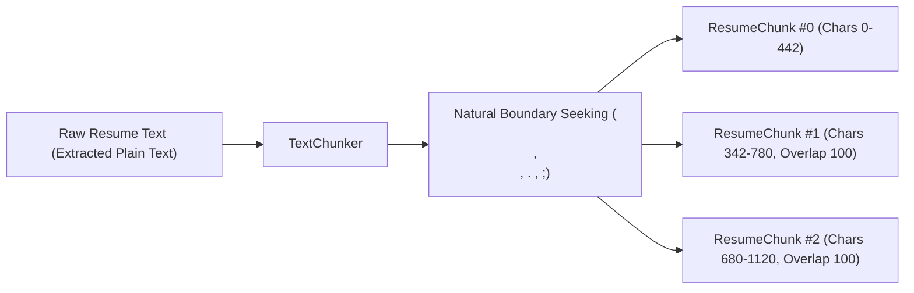
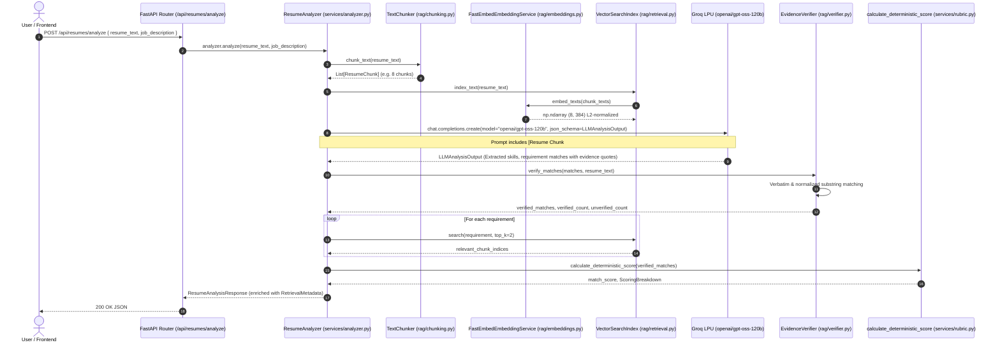

# HireLens — RAG (Retrieval-Augmented Generation) Architecture & Implementation

> **Phase 4 Implementation:** Complete  
> **Status:** Live & Production-Ready  
> **Backend Architecture:** FastEmbed ONNX Runtime + In-Memory Dense Vector Index + Programmatic Evidence Verification  
> **LLM Provider:** Groq Cloud LPU (`openai/gpt-oss-120b`) with JSON Schema Structured Outputs

---

## 1. RAG in Simple Terms

Standard Large Language Models evaluate text by reading an entire document in one monolithic prompt context. For recruitment intelligence, this introduces two major failure modes:
1. **Context Smearing & Needle-in-a-Haystack:** Critical technical details (such as specific microservice throughput, latency metrics, or database replication configurations) get lost in dense resume paragraphs.
2. **Hallucination of Evidence:** When asked to prove a match, an LLM often paraphrases or synthesizes quotes that look plausible but never actually appeared in the candidate's original resume.

**Retrieval-Augmented Generation (RAG)** solves this by:
1. **Deconstructing** the candidate's resume into semantically coherent, overlapping chunks.
2. **Converting** chunks into mathematical vector representations (embeddings) that capture conceptual meaning.
3. **Retrieving** the most semantically relevant resume chunks for each stated job requirement using vector similarity.
4. **Grounding** the LLM by feeding it only verifiable source passages with strict instructions to cite exact quotes.
5. **Programmatically Verifying** every returned quote against the original resume text in Python before delivering the report.

---

## 2. The Chosen Embedding Model and Technical Rationale

### Model: `BAAI/bge-small-en-v1.5` via FastEmbed
- **Framework:** `fastembed` (v0.9.0) backed by `onnxruntime` (v1.31.0).
- **Vector Dimension:** 384 dimensions.
- **Weights Size:** ~67 MB (quantized ONNX format).
- **Execution Target:** Native CPU inference without requiring CUDA, PyTorch, or GPU hardware.

### Why FastEmbed Fits HireLens:
1. **Free-First & Zero Extra API Keys:** Unlike OpenAI (`text-embedding-3-small`) or Cohere, FastEmbed runs completely on the local host. Candidates and recruiters never incur recurring embedding API costs or risk third-party rate limits.
2. **Eliminates PyTorch Bloat:** Traditional `sentence-transformers` requires PyTorch (`torch`), which is a 2+ GB binary download that often has compilation conflicts on Windows with newer Python versions (such as Python 3.14). FastEmbed uses lightweight ONNX Runtime (~15 MB).
3. **High Retrieval Accuracy:** `bge-small-en-v1.5` from BAAI is one of the highest-ranked lightweight models on the MTEB (Massive Text Embedding Benchmark), outperforming many models three times its size.
4. **Deterministic Unit Testing Interface:** The architecture provides `BaseEmbeddingService`, allowing our test suite to use `MockEmbeddingService` for instant, zero-network unit tests.

---

## 3. Chunking Strategy and Boundary Preservation

### Strategy Details (`backend/services/rag/chunking.py`)
- **Default Chunk Size:** 450 characters (approximately 60–80 words).
- **Default Overlap:** 100 characters (~15–20 words).
- **Minimum Chunk Threshold:** 30 characters (filters out trailing noise or page headers).



### Trade-Offs & Design Rationale:
- **Why Character Windows with Boundary Seeking?** Bullet points in resumes often span 200–400 characters. Hard character splits break words mid-sentence; pure paragraph splits fail on poorly formatted resumes with single long lines. Our chunker seeks natural delimiters (`\n\n`, `\n`, `. `, `; `) within the overlap window, preserving complete thoughts.
- **Traceable Offsets:** Every `ResumeChunk` preserves `start_char` and `end_char` offsets relative to the source text, enabling UI highlighting.

---

## 4. Similarity Metric & Vector Retrieval Algorithm

### Cosine Similarity via Dot Product
Because all chunk vectors are L2-normalized ($||\vec{v}||_2 = 1.0$) upon generation:
$$\cos(\theta) = \frac{\vec{u} \cdot \vec{v}}{||\vec{u}||_2 ||\vec{v}||_2} = \vec{u} \cdot \vec{v}$$

```python
# Cosine similarity matrix multiplication in backend/services/rag/retrieval.py
scores = np.dot(self._embeddings, query_vec)
ranked_indices = np.argsort(scores)[::-1]
```

### Retrieval Configuration:
- **Top-K:** Default 2–3 chunks per requirement query.
- **Minimum Threshold:** Configurable `min_score` (default: `-1.0` to permit all ranked chunks, clamped to top-k).

---

## 5. End-to-End Data Flow & Service Boundaries



---

## 6. Programmatic Evidence Verification Strategy

In [`backend/services/rag/verifier.py`](file:///k:/code/HireLens/backend/services/rag/verifier.py), HireLens implements a rigorous verification pipeline:

1. **Exact Verbatim Match:** Checks if `quote in resume_text`.
2. **Normalized Substring Match:** If strict comparison fails, normalizes:
   - Strips enclosing quote characters (`"`, `'`, `“`, `”`).
   - Collapses sequences of whitespace, line breaks, and tabs to a single space.
   - Normalizes hyphens, en-dashes, and em-dashes (`—`, `–`, `-`).
   - Tests case-insensitive substring alignment.
3. **Unverified Citation Handling:**
   - If the quote does not appear in the original resume text:
     - `m.evidence_verified = False`
     - `m.is_inferred = True`
     - Prepends `"[Unverified Citation: Quote could not be confirmed verbatim in source resume] "` to `m.explanation`.
   - Protects recruiters from making hiring decisions based on fabricated quotes.

---

## 7. Privacy, Data Isolation & Index Lifecycle

| Dimension | Implementation Reality | Security / Privacy Guarantee |
| :--- | :--- | :--- |
| **Index Scope** | Ephemeral, in-memory object instance inside `ResumeAnalyzer.analyze()` | Created on demand for a single HTTP request. |
| **Cross-Candidate Isolation** | Complete ($100\%$) | Each request creates its own `VectorSearchIndex`. There is no shared global vector pool. Candidate A cannot see Candidate B's chunks. |
| **Data Persistence** | None ($0\%$) | When the HTTP response finishes, the Python garbage collector reclaims the vector array and chunk objects. Personal resume data is never saved to disk. |

---

## 8. API Changes & Backward Compatibility

The endpoint `POST /api/resumes/analyze` remains 100% backward-compatible. All new fields are additive:

### Added to `RequirementMatch`:
- `evidence_verified: Optional[bool]` — `true` if quote exists verbatim in resume; `false` if unverified.
- `relevant_chunk_indices: List[int]` — Indices of the top matching resume chunks (e.g. `[0, 2]`).

### Added to `ResumeAnalysisResponse`:
- `retrieval_metadata: Optional[RetrievalMetadata]` containing:
  - `total_chunks: int`
  - `chunk_size: int`
  - `chunk_overlap: int`
  - `embedding_model: str`
  - `verified_quotes_count: int`
  - `unverified_quotes_count: int`
  - `retrieval_strategy: str`

---

## 9. Setup & Verification Commands

### Run Full Test Suite on Windows PowerShell
```powershell
# Run all 31 backend tests (RAG, Extraction, Analysis)
backend\.venv\Scripts\python.exe -m pytest backend/tests/

# Run frontend TypeScript validation
cd frontend
npx tsc --noEmit

# Run frontend production build
npm run build
```

---

## 10. Limitations and Next Steps

1. **Document-Level Querying:** Currently, the index is built per-candidate resume. Future phases could index internal company engineering rubrics and job requirements into a shared knowledge base.
2. **Context Window Expansion:** For 10+ page resumes, top-k retrieval can dynamically select only the top 5 chunks per requirement rather than providing all chunks in the prompt context.
